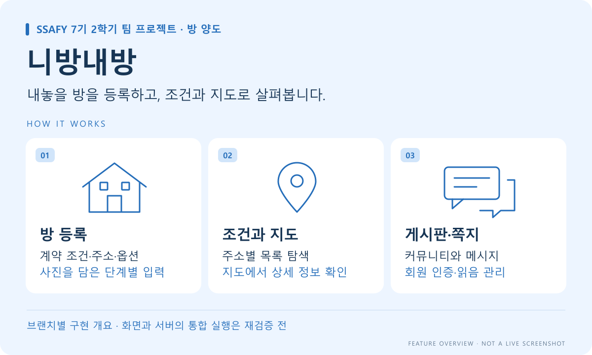

# 니방내방

**내놓을 방을 등록하고, 조건과 지도로 살펴봅니다.**

방 양도 정보를 등록하고 주소·계약 조건·지도로 방을 찾아보는 웹 서비스 프로젝트입니다. 게시판과 쪽지 기능도 구현했습니다.



**팀 프로젝트 · 기본 브랜치는 백엔드, 화면은 별도 frontend 브랜치**

### 핵심 기능

- **단계별 방 등록** — 계약 기간·보증금·집세·주소·옵션·사진을 입력합니다.
- **주소와 지도 탐색** — 주소로 목록을 찾고 지도에서 매물과 상세 정보를 확인합니다.
- **커뮤니티와 쪽지** — 게시글·댓글·스크랩, 쪽지의 읽음·삭제 상태를 관리합니다.

**기술:** React · Spring Boot · Spring Cloud · JPA

[서비스 구성](#서비스-구성) · [핵심 코드](#코드-살펴보기)

> 기본 브랜치 `BE/address`는 백엔드, [frontend 브랜치](https://github.com/ksmlucky/NIBANGNAEBANG/tree/frontend/frontend)는 화면입니다. 경로·요청 형식 차이가 있어 두 브랜치의 통합 실행은 별도 확인이 필요합니다.

---

<details>
<summary>상세 기능 펼쳐 보기</summary>

## 주요 기능

- **방 양도**: 계약 기간·보증금·집세·주소·옵션과 사진을 입력하는 단계별 등록 화면
- **방 찾기**: 주소 기반 목록 조회, 상세 정보·사진 확인, Kakao 지도에서 매물 선택
- **커뮤니티 API**: 게시글·댓글·대댓글, 좋아요·스크랩, 이미지 저장
- **쪽지 API**: 보낸·받은 쪽지함, 읽음 처리, 발신자·수신자별 삭제 상태 관리
- **회원 인증**: Kakao·Google OAuth2 연동 코드와 JWT·회원 정보 관리

등록·지도 화면은 `frontend`, 커뮤니티·쪽지는 `BE/address`의 백엔드 API 범위로 설명합니다.


</details>

## 서비스 구성

| 서비스 | 역할 |
| --- | --- |
| `apigateway-service` | API 요청 라우팅과 인증 헤더 처리 |
| `auth-service` | 로그인·인증 및 회원 관리 |
| `business-service` | 게시판·방 양도·메시지 등 주요 기능 |
| `config-service` | 서비스 설정 관리 |
| `discovery-service` | Eureka 기반 서비스 등록·탐색 |

<details>
<summary>기술 스택과 저장소 구성</summary>

버전은 각 서비스의 `build.gradle`과 프론트엔드의 `package.json` 기준입니다.

| 구분 | 기술 |
| --- | --- |
| 언어·프레임워크 | Java 11 대상, Spring Boot 2.7.5 |
| 서비스 구성 | Spring Cloud 2021.0.4, Gateway, Config, Eureka, OpenFeign |
| 데이터 접근 | JPA, QueryDSL, MariaDB 드라이버, Redis |
| 인증 | Spring Security, OAuth2, JWT |
| 프론트엔드 | React 18 계열, React Router, Redux Toolkit, MUI, CRACO |
| 지도·주소 | Kakao Maps, Daum 우편번호 검색 |

```text
backend/
  apigateway-service/
  auth-service/
  business-service/
  config-service/
  discovery-service/
configuration/
```

### 개발 환경 준비

각 서비스는 별도의 Gradle 프로젝트입니다. 전체 실행을 위해 서비스 설정과 DB·Redis·AMQP 브로커, OAuth 및 파일 저장소 연결 정보를 먼저 준비해야 합니다.

서비스별 빌드 명령 예시:

```bash
cd backend/business-service
./gradlew build
```

Windows에서는 `./gradlew` 대신 `gradlew.bat`를 사용합니다. 이 명령은 전체 서비스를 한 번에 실행하는 명령이 아니며, 실행 환경과 서비스 간 연결은 별도 구성해야 합니다.

### 브랜치 연결 시 확인할 점

`frontend` 브랜치의 화면은 `BE/address` API와 일부 경로·데이터 형식이 다릅니다. 예를 들어 등록 화면은 `/api/article/AT`에 요청하지만 이 기본 브랜치의 등록 API는 `/api/article`입니다. 화면의 `monthlyRent`와 기본 브랜치의 `rent` 필드도 다릅니다.

따라서 두 브랜치를 그대로 조합해 전체 앱이 실행된다고 보장할 수 없습니다. 맞는 백엔드 버전과 API 계약을 먼저 확인해야 합니다. 현재 외부 서비스 연결과 통합 실행은 재검증하지 않았습니다.

</details>

## 코드 살펴보기

- [양도 정보·이미지·게시글 저장](backend/business-service/src/main/java/com/footprints/businessservice/app/domain/board/article/service/ArticleServiceImpl.java)
- [주소 필터와 게시글 조회](backend/business-service/src/main/java/com/footprints/businessservice/app/domain/board/article/repository/ArticleRepositoryImpl.java)
- [쪽지 읽음·삭제 처리](backend/business-service/src/main/java/com/footprints/businessservice/app/domain/message/service/MessageServiceImpl.java)
- [단계별 등록 화면](https://github.com/ksmlucky/NIBANGNAEBANG/blob/a45d8bdd949fadd5f086bdfcccb261e69d121a86/frontend/src/screens/room/Questions.jsx)
- [지도와 매물 상세 연결](https://github.com/ksmlucky/NIBANGNAEBANG/blob/a45d8bdd949fadd5f086bdfcccb261e69d121a86/frontend/src/components/room/MapList.jsx)
